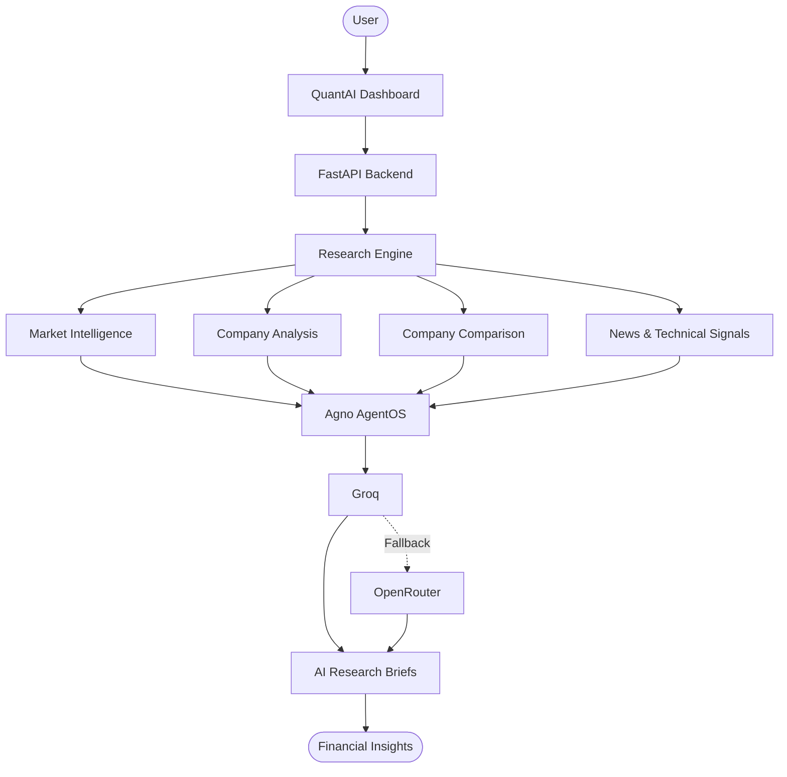

# QuantAI
### Financial Intelligence. Clear Evidence. Better Decisions.

An Apple-inspired financial research platform powered by Python, FastAPI and Agno AgentOS.

## How It Works



## Features

- **Market Intelligence** — Prices, charts and technical indicators.
- **Company Analysis** — Financials, fundamentals and valuation.
- **Company Comparison** — Side-by-side company analysis.
- **News & Events** — Relevant market updates.
- **AI Research Desk** — Intelligent financial research and summaries.
- **Light & Dark Themes** — Clean, responsive Apple-inspired interface.

## Tech Stack

| Layer | Technologies |
|---|---|
| Backend | Python 3.12, FastAPI |
| AI | Agno AgentOS, Groq, OpenRouter |
| Frontend | Jinja2, HTMX, JavaScript |
| Charts | Chart.js 4.x |
| Styling | Tailwind CSS |
| Deployment | Vercel |

## Architecture

- FastAPI entrypoint: `api/index.py`
- Production runtime: Vercel Python Functions
- Templates: Jinja2
- Static assets: `static/`

## Local Setup

```powershell
python -m venv .venv
.\.venv\Scripts\Activate.ps1

python -m pip install -r requirements.txt

.\.venv\Scripts\uvicorn.exe index:app --port 8000 --host 127.0.0.1 --reload
```

Create `.env` from `.env.example` and configure your API credentials.

## Environment Variables

`GROQ_API_KEY_PRIMARY`, `GROQ_MODEL_PRIMARY`, `GROQ_API_KEY_SECONDARY`, `GROQ_MODEL_SECONDARY`, `OPENROUTER_API_KEY`, `OPENROUTER_MODEL`, `AI_PROVIDER_ORDER`, `QUANTAI_DEVTOOLS`.

Keep all API keys private and server-side.

## Documentation

- [Deployment Guide](VERCEL_DEPLOYMENT.md)
- [Feature Checklist](PARITY_CHECKLIST.md)

---

**QuantAI — Smarter Research. Clearer Insights.**
