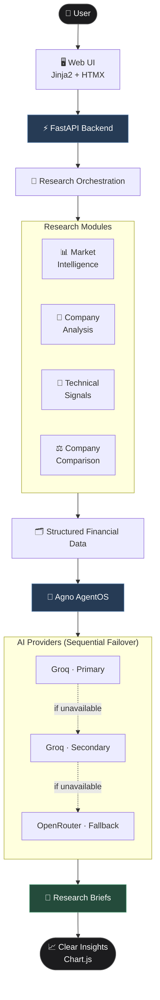

<div align="center">

# 📈 QuantAI

**Financial Intelligence. Clear Evidence. Better Decisions.**

AI-powered financial research platform — market data, company analysis and technical signals in one clean workspace.


</div>

---

## ✨ Features

| | Feature | What it does |
|---|---|---|
| 📊 | **Market Intelligence** | Prices, history, volume and technical indicators |
| 🏢 | **Company Deep Analysis** | Fundamentals, financials and valuation |
| ⚖️ | **Company Comparison** | Side-by-side comparison of multiple companies |
| 📡 | **Technical Signals** | Deterministic market signals |
| 📰 | **News & Events** | Company news and corporate events |
| 🧠 | **AI Research Briefs** | Structured, AI-generated insights |
| 💬 | **Research Assistant** | Chat with the Agno AgentOS research desk |

---

## 🔄 How It Works



---

## 🧰 Tech Stack

| Layer | Tools |
|---|---|
| **Backend** | Python 3.12 · FastAPI · Pydantic · Agno AgentOS |
| **Frontend** | Jinja2 · HTMX · Vanilla JS · Chart.js 4 · Tailwind CSS |
| **AI** | Groq (primary + secondary) · OpenRouter (fallback) |
| **Deploy** | Vercel Serverless (60s max duration) |

---

## 🛡️ Security & Reliability

- 🔒 SSRF protection — private, loopback and cloud-metadata addresses blocked
- 🔑 API keys stay server-side
- 🔁 Automatic AI provider failover
- 🚦 Rate limiting + concurrency protection
- ⚡ TTL caching + single-flight request coalescing

---

## 🚀 Quick Start

```powershell
# 1. Clone
git clone https://github.com/SamSurve/QuantAI.git
cd QuantAI

# 2. Virtual environment
python -m venv .venv
.\.venv\Scripts\Activate.ps1

# 3. Install
python -m pip install -r requirements.txt

# 4. Configure — copy .env.example to .env and add your keys

# 5. Run
uvicorn index:app --port 8000 --host 127.0.0.1 --reload
```

Run tests: `python -m pytest -q`

---

## ⚙️ Environment Variables

| Variable | Purpose |
|---|---|
| `GROQ_API_KEY_PRIMARY` / `GROQ_MODEL_PRIMARY` | Primary AI provider |
| `GROQ_API_KEY_SECONDARY` / `GROQ_MODEL_SECONDARY` | Secondary Groq failover |
| `OPENROUTER_API_KEY` / `OPENROUTER_MODEL` | Fallback provider |
| `AI_PROVIDER_ORDER` | Provider priority |
| `QUANTAI_DEVTOOLS` | Debug telemetry — keep **off** in production |

> ⚠️ Never commit `.env` files or expose API keys in client-side code.

---

## ✅ Quality

**364** automated tests passing · **21** UI features audited · **7** infra/security checks · Ruff clean · Desktop, mobile, light & dark verified

---

## 📚 Docs

[`PARITY_CHECKLIST.md`](PARITY_CHECKLIST.md) · [`VERCEL_DEPLOYMENT.md`](VERCEL_DEPLOYMENT.md) · [`migration/PROGRESS.md`](migration/PROGRESS.md)

<div align="center">

**QuantAI — Making financial research clearer, more structured and easier to understand.**

</div>
